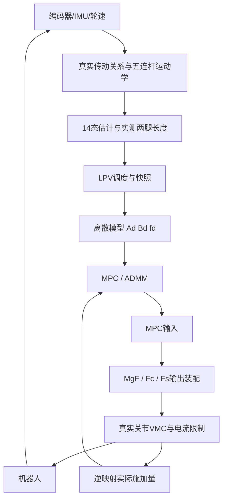

# RoboMaster 同轴双驱动五连杆 MPC：从物理模型到代码的详细探索

日期：2026-10-23（Asia/Shanghai）  
审计对象：当前 `mixmpc_pre` 工程；新增交付位于 `mixmpc/`。  
机构前提：用户本次确认“**实机为同轴双驱动五连杆或等效传动**”。因此本文以同轴五连杆为主模型，不把“缺少真实髋—膝串联转换”判为当前实机的已确认错误。

新增基线信息：用户进一步确认父目录 `balance_mpc/`、`leglen_mpc/` 是**已经实车跑通的两条原控制链**。本次已读取原目录并加入第 16 节的逐项融合对照。原实车成功作为有效经验背景接受；以下物理疑点须区分继承近似与融合新增问题，不表示原车“不能运行”。

## 0. 先给结论

**这份工程已经形成可编译、可执行、能与独立优化解对照的 14 状态、6 输入 LPV MPC；但它目前还不是从真实机构完整推导并独立验证的七自由度整机动力学模型。**

本次验证支持以下判断：

1. 非奇异工作带内，五连杆正运动学、速度映射、虚功力矩映射相互一致，并与独立圆圆求交、隐式求导参考一致。用户确认的机构类型支持这条建模路径。
2. 当前简化动力学核到 A/B/f 的线性化、仿射展开、ZOH 离散化基本自洽；旧报告中已经修复的仿射锚定、绝对高度重复加偏置、直接水平腿力重复计入，不应再次列为现存错误。
3. 当前 C 主机测试、ASan/UBSan 均通过；另用独立凝聚 QP 对 12 个案例进行对照，部署容差下控制解接近独立解。
4. **最需要继续修正的不是盲目调 Q/R，而是物理口径、模型缺项和输出异常处理。** 优先项包括：腿惯量参考轴矛盾；径向广义力与地面法向力混用风险；外层补偿与原始动力学尚未证明等价；仅平均腿角调度；高度/横滚与腿长几何闭合；一个已复现的 NaN 导致气弹簧补偿消失的问题。
5. MATLAB/Octave 不在本机 PATH，本次没有执行 MATLAB 全链生成；没有烧录硬件、测量 MCU 最坏执行时间或获取 CAD 质量属性。历史日志与本次新运行证据在下文分开记录。

本次是审计和探索交付，**没有修改 `mpc/`、`solver/`、`staging/`、`tool/` 中的生产源文件，也没有向配置中的固件目录部署**。新增脚本用于复现证据，不是已完成部署的补丁。

### 0.1 证据等级

| 标记 | 含义 | 例子 |
|---|---|---|
| 实跑确认 | 本次执行程序得到的结果 | C 测试、独立 QP、NaN 补偿反例 |
| 代码确认 | 直接由当前源码确定的行为 | 仅平均 psi 调度、NH=8 表示 7 个控制区间 |
| 条件性物理结论 | 在明确机构、参考轴、接触假设下成立 | 绕髋惯量不能小于 `m*d²`；接地轮重不进入髋高度的广义重力 |
| 待标定/待集成 | 文件不足以决定实机事实 | 惯量实际参考轴、编码器传动比、摩擦系数、WCET |
| 历史记录 | 已有报告/日志声称完成，本次未重跑相应工具链 | AC5 链接数据、MATLAB 闭环日志 |

“某个测试 PASS”只证明那个测试所覆盖的性质，不能自动提升为“实机物理模型正确”。

## 1. 工程地图与真正的执行链

| 层次 | 主要文件 | 本次如何使用 |
|---|---|---|
| 硬件常数 | [leg4_hardware.m](../tool/leg4_hardware.m) | 读取当前参数，不将注释等同新测量 |
| 机构运动学/VMC | [Leg_Pos.m](../tool/Leg_Pos.m)、[Leg_Spd.m](../tool/Leg_Spd.m)、[Leg_Trq.m](../tool/Leg_Trq.m)、[Leg_InvTrq.m](../tool/Leg_InvTrq.m) | 独立几何与虚功对照 |
| 质量/补偿参数 | [leg_data.m](../tool/leg_data.m)、[leg4_sym7_config.m](../mpc/leg4_sym7_config.m) | 参考点、平行轴下界、参数分叉检查 |
| 连续动力学 | [leg4_bal_block.m](../mpc/parts/leg4_bal_block.m)、[leg4_fused_dyn.m](../mpc/parts/leg4_fused_dyn.m) | 重建当前简化核，区别完整物理模型 |
| 线性化与平衡 | `leg4_fused_ab.m`、`leg4_fused_op.m`、`leg4_fused_eq.m`、`leg4_equilibrium.m` | 雅可比、仿射一致性与真正平衡点 |
| 离散化/LPV | `leg4_zoh_ab.m`、`s04d_leg4_lpv_psi.m`、`leg4_lpv_eval.m` | 独立矩阵指数、离网误差与调度范围 |
| 优化器 | [leg4_admm.c](../solver/leg4_admm.c)、`leg4_admm.m`、`leg4_project_input.m` | 优化目标、投影、独立凝聚 QP |
| 运行时 | [leg4_tinympc.c](../solver/leg4_tinympc.c)、[leg4_tinympc_async.c](../solver/leg4_tinympc_async.c) | 采样快照、序列年龄、回退、实际输入反馈 |
| 输出补偿 | [leg4_comp.c](../solver/leg4_comp.c)、`leg4_runtime_step.m` | 气弹簧/重力/向心补偿与 NaN 传播 |
| 生成与部署 | `leg4_build_and_verify.m`、`leg4_deploy.m`、`leg4_data_manifest.m` | 构建入口、清单、依赖及边界 |
| 历史材料 | [旧审计报告](../docs/混合MPC审计与修复_2026-10-23.md)、`build/migration_leg3_20261023/` | 理解来源，不覆盖当前源码事实 |

历史目录中实际存在 `Tool/leg_vmc_generate.mlx` 和 `lqr/推导-v2.md`，不能说整个工程没有原始推导。它们没有位于当前 `tool/` 生成入口所描述的位置，且属于历史迁移材料，应恢复清楚的版本和引用关系。



重要的是每条箭头的物理定义。两个节点数值能对拍，不意味着中间省略的传动、反作用或饱和不存在。

## 2. 机构模型：为什么当前五连杆运动学基本成立

### 2.1 当前代码假设

`tool/README_VMC.md:3` 和生成函数给出：两髋同轴，`l5=0`，两条近端杆长 `a=0.21 m`，两条远端杆长 `b=0.25 m`。主动角为 `phi1,phi4`。末端是轮轴，不是轮地接触点。

在机构平面中定义：

\[
B=a[\cos\phi_1,\sin\phi_1]^T,\qquad
D=a[\cos\phi_4,\sin\phi_4]^T.
\]

轮轴 C 同时满足：

\[
\|C-B\|^2=b^2,\qquad\|C-D\|^2=b^2.
\]

令 `d=D-B`、`r=||d||`、`e=d/r`、`n=[-e_y,e_x]`，则独立的圆圆求交形式为：

\[
C=\frac{B+D}{2}\pm\sqrt{b^2-r^2/4}\,n.
\]

正负号对应不同装配分支，必须与真实膝部朝向一致，不能每拍随意选择最近数学解。

输出坐标：

\[
L=\|C\|,\quad\phi_0=\operatorname{atan2}(C_y,C_x).
\]

`Leg_Pos.m:8` 的 `phi0` 从 `+x` 轴量起，局部 `+y` 标为向下。MPC 的 `psi` 则是世界系腿角。历史生成材料出现过 `phi0-pi/2` 的转换，但真实固件仍需把左右镜像、IMU pitch 正方向、编码器零点统一到一张表；不能只因角度单位都是 rad 就直接接线。

### 2.2 独立速度雅可比

对两条闭链约束求导，令 `v=Cdot`：

\[
\begin{bmatrix}(C-B)^T\\(C-D)^T\end{bmatrix}v
=
\begin{bmatrix}(C-B)^TB_{\phi_1}&0\\0&(C-D)^TD_{\phi_4}\end{bmatrix}
\begin{bmatrix}\dot\phi_1\\\dot\phi_4\end{bmatrix}.
\]

因此先得到笛卡尔雅可比 `J_C`，再由极坐标转换得到：

\[
J_{L\phi}=
\begin{bmatrix}C_x/L&C_y/L\\-C_y/L^2&C_x/L^2\end{bmatrix}J_C,
\quad[\dot L,\dot\phi_0]^T=J_{L\phi}\dot q_a.
\]

这条推导没有使用 `Leg_Spd` 的中间代数表达式，适合作为独立参考。

### 2.3 VMC 的正确力矩关系

由瞬时功率一致：

\[
\tau_a^T\dot q_a=F_L\dot L+T_p\dot\phi_0,
\qquad
\tau_a=J_{L\phi}^T\begin{bmatrix}F_L\\T_p\end{bmatrix}.
\]

这里 `F_L` 是与 L 共轭的**径向广义力**，`Tp` 是与腿角共轭的虚拟力矩。`Tp` 与笛卡尔切向力之间还隔着长度：`F_t=Tp/L`，不能把 Nm 与 N 直接混用。这与标准雅可比转置力映射一致。参考：[Modern Robotics：Statics of Open Chains](https://modernrobotics.northwestern.edu/nu-gm-book-resource/5-2-statics-of-open-chains/)。

### 2.4 本次实际验证

脚本：[physics_independent_checks.py](validation/physics_independent_checks.py)；结果：[physics_results.json](validation/physics_results.json)。随机种子 `20261023`，接受工作带 `L∈[0.16,0.34] m` 内的 1406 个非奇异构型。

| 比较项 | `.m` 标量表达式机械转译到 Python，对独立参考 | 当前生成 C + libm 影子接口，对独立参考 |
|---|---:|---:|
| 腿长最大误差 | `1.20e-14 m` | `1.65e-6 m` |
| 腿角最大误差 | `4.84e-14 rad` | `6.76e-6 rad` |
| 雅可比最大元素误差 | `3.40e-14` | `4.74e-6` |
| 力矩最大误差 | `8.26e-13 Nm` | `8.32e-4 Nm` |
| 功率等式最大残差 | `7.85e-13 W` | `1.48e-3 W` |

`.m` 一列不是 MATLAB 运行结果；C 一列不是 MCU 实际 CMSIS 查表三角函数结果。它们证明公式和此主机编译路径一致，不能替代 CMSIS 误差和实机传动验证。

### 2.5 奇异性没有被腿长范围自动排除

`phi1=phi4` 时 B=D，两圆约束退化，轮轴位置不再由这两个主动角唯一确定。当前生成 C 在 `(phi1,phi4)=(2,2)` 返回有限腿长约 `0.250808 m`，但速度与力矩已经非有限。这点就在标称腿长带内。

因此只检查 `0.16≤L≤0.34` 不够。应增加：装配分支、闭链约束矩阵最小奇异值、归一化雅可比条件数、有限性和关节限位检查。`Leg_InvTrq` 的 Tikhonov 正则化不能修复输入雅可比本身的 NaN/Inf，也不能恢复奇异构型丢失的物理可控方向。

### 2.6 “等效传动”需要守住的边界

用户确认了同轴双驱动五连杆或等效传动，因此当前首选是验证主动角是否确实对应 `phi1,phi4`。若电机坐标 `q_m` 与主动角满足 `q_a=h(q_m)`，则：

\[
J_m=J_{L\phi}\frac{\partial h}{\partial q_m},\qquad
\tau_m=\left(\frac{\partial h}{\partial q_m}\right)^T\tau_a.
\]

这涵盖减速比、皮带/齿轮传动、耦合机构和左右镜像。单纯改角度符号而漏改力矩对偶，会破坏功率一致。

仅作条件性反例：如果以后改成真正髋—膝串联腿，不能把相对膝角直接传给 `phi4`。验证脚本保留一个串联例：相同端点和 `F=100 N,Tp=3 Nm`，串联关节力矩为 `[3,20.9725] Nm`，等价五连杆虚拟主动矩为 `[-13.2262,16.2262] Nm`；必须经过上述坐标雅可比转置才能等价。**这不是本次已确认实机的结构错误。**

## 3. 参数：标量统一不等于质量属性已经一致

### 3.1 当前数值

| 参数 | 当前值 | 解释 |
|---|---:|---|
| 轮半径 `Rw` | 0.0525 m | 不要与历史文档中“外径”的措辞混用 |
| 半轮距 `b` | 0.212755 m | 全轮距 0.42551 m |
| 机身质量 `mb` | 20.534 kg | 是否包含电池、云台等应与 CAD 对齐 |
| 单腿质量 `ml` | 1.855 kg | 两腿各一份 |
| 单轮质量 `mw` | 0.65 kg | 地面支持与机构径向力需分别记账 |
| 总质量 | 25.544 kg | `mb+2ml+2mw` |
| 机身加两腿质量 | 24.244 kg | 向心补偿当前使用此值 |
| `Mv` | 25.544 kg | 当前锁定等效竖直惯量，不是推导完成的证据 |
| `Iroll` | 0.578 kg·m² | 需要明确参考轴 |
| `lc` | 0.01863 m | 机身质心对俯仰转轴偏置及方向必须明确 |

### 3.2 已证实的惯量定义矛盾

`tool/leg_data.m:21–34` 将 `ld` 定义为髋到腿质心距离，将 `Ileg` 定义为绕髋/pitch 转轴惯量。若这两个定义和 `ml=1.855 kg` 同时正确，则平行轴定理要求：

\[
I_{hip}=I_{COM}+m_l l_d^2,\quad I_{COM}\ge0.
\]

本次重新计算：**19/19 行都得到负的 `I_COM`**，范围为 `[-0.04664578,-0.00901197] kg·m²`。在 L=0.27 m：

\[
I_{table}=0.01794632335,\qquad
I_{table}-1.855(0.16107)^2=-0.03017895244.
\]

这不是四舍五入误差。能够确认的是“参考轴/质量/质心距离说明不能同时成立”，不能凭此决定究竟该把惯量加多少。

**解决方法：** 导出实际装配各构件质量、质心和质心惯量；明确当前 `Ileg` 是绕质心、髋、轮轴，还是消元模型的等效系数；统一到推导所需参考点再重新生成表。若表是经验辨识得到的等效参数，应明确这样命名，不能继续把它声称为 CAD 绕髋惯量。

### 3.3 两套质心描述尚未统一

平衡模型使用 `cfg.Leg_data=[L,lw,lb,Ileg]`；重力补偿使用 `cfg.Leg_comp=[L,theta0,ld]`；VMC 补偿的 `tool/leg_data.m` 还有一份表；C 的 `leg4_comp_table` 又硬编码一份。

如果前者是轴向质心距离、后者是同一实际质心的极坐标，则必须解释它们的几何转换。在 L=.27 m：

\[
l_w^{(B)}=0.16291,\qquad
L-l_d\cos\theta_0=0.1200427364\ \mathrm{m}.
\]

差 `42.87 mm`。此外 `lw+lb-L` 在当前表中最小为 `-13.64 mm`。若变量是非共线两点的真实距离，不能直接要求相加等于 L；但此时方程中把它们当共线力臂使用的依据也必须补齐。

相同 L=.27，B 族重力斜率为 `30.15876577 Nm/rad`，A0 族为 `29.37868660 Nm/rad`，不是同一组参数的简单重命名。

**解决方法：** 建立单一硬件数据文件，记录每个参数的物理点、参考轴、坐标和单位；所有 MATLAB/C 表由同一数据生成。参数一致性应由测试检查，不应靠复制时“看上去差不多”。

## 4. 状态和输入到底是什么

### 4.1 当前状态顺序

\[
x=[s,\dot s,\gamma,\dot\gamma,\psi_L,\dot\psi_L,
\psi_R,\dot\psi_R,\theta,\dot\theta,\alpha,\dot\alpha,
H-H_{ref},\dot H]^T.
\]

`gamma` 为 yaw，`theta` 为 pitch，`alpha` 为 roll。角度为 rad，长度为 m。`H_REF=.27 m`。调度包 H 是绝对量；只有状态第 13 项减去 H_REF。

当前配置明确 `psiL/psiR` 已是世界腿角，不能在补偿层又重复加一次 pitch。原始 `Leg_Pos` 角和世界 psi 之间仍需正确的编码器、镜像和姿态转换。

### 4.2 一个容易接错的状态：s 不是自动等于机身位移

`leg4_bal_block.m:87–91` 的变换矩阵第一行是：

\[
\ddot s=\frac{R_w}{2}(\ddot\vartheta_{wL}+\ddot\vartheta_{wR}).
\]

所以当前 s 对应**轮轴平均滚动位移**。在小角、冻结腿长时，髋中点位移约为：

\[
x_{hip}=s+\frac{L_L\sin\psi_L+L_R\sin\psi_R}{2}.
\]

若还要机身质心位置，还需机身质心偏置项。不能把 IMU 融合的机身前向速度直接当 `dot s`，而完全不扣腿摆动速度。

历史 `build/migration_leg3_20261023/lqr/推导-v2.md` 的 `Xb` 包含腿摆动项；当前 M5 的直接来源却是 `balance_mpc/s01_build_tinympc_cache.m:58–63` 的方程 (19)–(23)。两套历史材料的状态、符号、重力方向不同，不能混用其结论。

**解决方法：** 在固件接口建立 `estimator_to_mpc_state()`，明确 s 是轮轴平均位置还是机身位置。如果改用机身坐标，应整体做状态变换 `x_new=S*x_old`、`A_new=S*A_old/S`、`B_new=S*B_old`，并同步 Q、参考和观测；当 S 随构型变化时还必须考虑 `dot S*x`。

### 4.3 六路输入与输出装配

\[
u_{mpc}=[T_{wL},T_{wR},T_{BL},T_{BR},F_{mpc,L},F_{mpc,R}]^T.
\]

前四路 Nm，后两路 N。实际输出链：

\[
T_{wheel,act}=-T_w,
\quad T_p=T_B+M_g,
\quad F_{total}=\operatorname{limit}(F_{mpc}+F_c),
\quad F_{motor}=F_{total}-F_s.
\]

其中 `limit` 包含箱和变化率限制。`Ftotal` 此处是代码定义的“含气弹簧的机构输入”，**还没有因此自动成为轮地法向力 N**。实际地面反力应由轮和机构动力学计算/估计。

## 5. 从现有五条平衡方程到 10 态 A/B

本节验证的是“代码是否实现它所声明的简化方程”，并不把该方程组当作已证实的完整真实动力学。

令：

\[
\eta=[\vartheta_{wL},\vartheta_{wR},\psi_L,\psi_R,\theta]^T,
\quad\xi=[\psi_L,\psi_R,\theta]^T,
\quad u_T=[T_{wL},T_{wR},T_{BL},T_{BR}]^T.
\]

当前装配关系是：

\[
M_5\ddot\eta=N_x\xi+N_u u_T+d_g.
\]

用 `aL=lwL,cL=lbL,IL=IlegL`，右侧类似，定义：

\[
\begin{aligned}
p_i&=I_wL_i/R_w+m_wR_wL_i+m_lR_wc_i,\\
q_i&=m_la_ic_i-I_i,\\
d&=(m_w+m_l+m_b/2)R_w^2+I_w,\\
e_i&=R_w(m_la_i+m_bL_i/2),\\
h&=l_c[(m_w+m_l)R_w+I_w/R_w],\\
j&=I_zR_w/(2b)+I_wb/R_w.
\end{aligned}
\]

则：

\[
M_5=\begin{bmatrix}
p_L&0&q_L&0&0\\
0&p_R&0&q_R&0\\
-d&-d&-e_L&-e_R&0\\
h&h&m_la_Ll_c&m_la_Rl_c&-I_b\\
j&-j&I_zL_L/(2b)&-I_zL_R/(2b)&0
\end{bmatrix}.
\]

B 族下：

\[
k_i=(m_la_i+m_bL_i/2)g,
\quad N_x=\begin{bmatrix}-k_L&0&0\\0&-k_R&0\\0&0&0\\0&0&-m_bgl_c\\0&0&0\end{bmatrix},
\quad d_g=0.
\]

\[
N_u=\begin{bmatrix}
1+L_L/R_w&0&-1&0\\
0&1+L_R/R_w&0&-1\\
-1&-1&0&0\\
l_c/R_w&l_c/R_w&1&1\\
b/R_w&-b/R_w&0&0
\end{bmatrix}.
\]

加速度坐标变换：

\[
T=\begin{bmatrix}
R_w/2&R_w/2&0&0&0\\
-R_w/(2b)&R_w/(2b)&-L_L/(2b)&L_R/(2b)&0\\
0&0&1&0&0\\0&0&0&1&0\\0&0&0&0&1
\end{bmatrix}.
\]

于是 10 态块有：

\[
A_{10}(1{:}2{:}9,2{:}2{:}10)=I_5,
\quad A_{10}(2{:}2{:}10,5{:}2{:}9)=TM_5^{-1}N_x,
\]
\[
B_{10}(2{:}2{:}10,:)=TM_5^{-1}N_u,
\quad f_{10}(2{:}2{:}10)=TM_5^{-1}d_g.
\]

代码使用 `M\Nx`、`M\Nu`，没有显式求逆，这点正确。独立重建的标称 `cond(M5)=24.54`，本次 200 个离网点最大约 `36.50`，未发现该范围内代数消元奇异。

**M5 非对称不构成单独的物理否证。** 它是消去内力并缩放后的方程系数，不必等于由动能二阶导得到的广义质量矩阵。完整拉格朗日质量矩阵才应满足对称、正定等结构；应比较最终动力学或重建坐标/行变换，不能只看 `M5-M5'`。

### 5.1 一个可独立检查的水平动量关系

当前冻结腿长、近直立近似中应满足：

\[
-\left(m_b+2m_l+2m_w+\frac{2I_w}{R_w^2}\right)\ddot s
-(m_la_L+m_bL_L/2)\ddot\psi_L
-(m_la_R+m_bL_R/2)\ddot\psi_R
+\frac{T_{wL}+T_{wR}}{R_w}=0.
\]

把额外 `FL*sin(psiL)+FR*sin(psiR)` 直接加到已经消掉内部腿力的 s 方程，会破坏这条关系。当前 `sw_fused.F_pitch=0` 已关闭该做法，是正确的修复方向。它不等于“腿长永远不影响前进运动”：真实影响应通过几何约束、质量矩阵和变长运动项进入。

## 6. 高度/横滚四态：实现公式清楚，物理定义仍有缺口

当前部署的 `F_H_proj=Ts_H=Ts_alpha=1`，由 `leg4_fused_dyn.m:16–31` 得：

\[
\ddot H=\frac{-M_{tot}g-K(H-H_{ref})-D\dot H
+F_L\cos\psi_L+F_R\cos\psi_R
+(T_{wL}\sin\psi_L+T_{wR}\sin\psi_R)/R_w}{M_v},
\]

\[
\ddot\alpha=G_\alpha\alpha+
\frac{b}{I_\alpha}\left[F_L\cos\psi_L-F_R\cos\psi_R
+(T_{wL}\sin\psi_L-T_{wR}\sin\psi_R)/R_w\right].
\]

当前 `K=0,D=8,Galpha=0`。注意开关名 `Ts_H` 中的 Ts 指轮矩耦合，不是采样周期 Ts。

### 6.1 径向广义力不等于地面法向力

轮保持接地、轮心高度固定时，轮重通过轮地法向力承受。若广义坐标 H 只移动机身/腿而不移动轮心，轮子势能对 H 的导数为零：

\[
\partial(m_wgR_w)/\partial H=0.
\]

因此不能一方面把 F 当 VMC 的径向执行器广义力，另一方面直接用 `Mtot*g` 当它的静态合力，并默认两者等价。

当前直立基准每腿 `Mtot*g/2=125.29332 N`。即使采用“机身与全部腿质量一起竖直平移”的粗略模型，也仅为 `118.91682 N/腿`，相差一只轮的重量 `6.3765 N/腿`。**后者也不是建议直接替换的正确值**：腿内各连杆质心随伸缩的速度比例还需计算。

**解决方法：** 先定义到底以 `F_L` 还是 `N_ground` 为优化输入。若以径向力为输入，从虚功/拉格朗日方程导出 H 行；若以地面反力为输入，则必须通过机构/轮动力学转换成径向力和切向作用，再送 VMC。不能只换一个质量数字。

### 6.2 `Mv_mode='derived'` 不是完整的质量矩阵推导

`leg4_mv_pick.m:5–6` 给出：`Mv=mb+2*ml*(1-dld/dL)`。一阶质心位移导数可以进入重力广义力，但惯性应来自动能：

\[
M_{HH}=\sum_i m_i\left\|\frac{\partial r_i}{\partial H}\right\|^2
+\sum_i J_{\omega i,H}^T I_iJ_{\omega i,H}.
\]

例如 `z_leg=H-ld(H)*cos(theta0(H))`，则竖直速度比例为 `1-d(ld*cos(theta0))/dH`，惯性贡献是其平方，并可能还有水平质心运动和杆件转动贡献。单用 `1-dld/dL` 既忽略偏角变化，又不满足上述动能形式。

当前部署锁定 `Mv=25.544`，所以这个问题主要是**备用 derived 模式的推导缺陷**；不能通过切换到 derived 就宣称已恢复真实变长动力学。

### 6.3 轮矩竖直投影需要重新从受力图证明

轮接触处的切向地面力在水平地面上是水平力。轮轴处通过腿传递的力，必须由轮的平动、转动和腿部约束一起求出。`Tw/Rw` 只是非常特定条件下的切向力尺度，不是任意情况下可直接乘 `sin(psi)` 的已知独立支撑力。

当前两项保留在代码中，但缺少独立完整受力/能量推导。应从统一模型消元后检查它们是否出现、符号如何、是否还伴随 `Iw*theta_w_ddot`、髋矩切向作用和变长项。**本次不把“看起来像投影”当成物理证明，也不在没有替代推导时直接删除它们。**

## 7. 为什么当前模型还不能称完整七自由度动力学

当前 `leg4_fused_dyn` 是“固定几何线性平衡块＋两条非线性投影方程”。完整变长腿至少满足：

\[
x_h=x_w+L\sin\psi,\qquad z_h=R_w+L\cos\psi.
\]

二阶导数为：

\[
\ddot x_h=\ddot x_w+\ddot L\sin\psi
+2\dot L\dot\psi\cos\psi+L\ddot\psi\cos\psi
-L\dot\psi^2\sin\psi,
\]
\[
\ddot z_h=\ddot L\cos\psi-2\dot L\dot\psi\sin\psi
-L\ddot\psi\sin\psi-L\dot\psi^2\cos\psi.
\]

旧 `s01` 已能符号打印这些项，但当前运行核没有因 `kin_ldot=1` 就实现它们。实时查表更新 L 也不能自动补出 `dot L`、`ddot L` 和科氏项。

在完全静止、psi=0 的展开点，部分速度乘积确实是一阶零项；在非零腿角、快速伸缩或高速摆动下则不能忽略。可接受的降阶模型应给出误差适用域，而不是把静止点线性化结论外推到跳跃、落地或剧烈侧倾。

### 7.1 建议的完整推导路线

1. 固定平地双轮接触模式，选一组无冗余广义坐标；可以从机身位姿与各关节坐标出发，也可以通过约束消元保留所需 7 个位置自由度。明确非完整滚动约束，不凭状态数判断机械自由度。
2. 为每个实际刚体建立 `r_i(q),R_i(q)`、质量和质心惯量。
3. 构造动能和势能：`T=1/2 Σ(mi*vi²+omega_i' Ii omega_i)`，`V=Σmi*g*zi`；气弹簧若在物理 plant 中建模，要保持与控制补偿接口一致。
4. 从 `d/dt(∂L/∂qdot)-∂L/∂q` 得到 `M(q)qdd+C(q,qdot)qdot+g(q)`。
5. 加入真实电机力矩映射、轮地约束、法向/摩擦力；使用约束动力学或消元，避免内力重复计数。
6. 最后做输出补偿的输入变换、线性化和模型降阶；用完整 plant 验证降阶误差。

这是标准多体动力学构造路线，参考：[MIT Underactuated Robotics：Multi-Body Dynamics](https://underactuated.mit.edu/multibody.html)。该来源提供方法，不提供你这台机器的质量属性或替代标定值。

## 8. 外置补偿：实现边界必须由物理等式验证

### 8.1 气弹簧

`Leg_SpringF` 使用虚功关系：

\[
F_s(L)=F_{gas}\frac{d\ell_{spring}}{dL}.
\]

恒气弹簧推力不意味着等效径向力恒定，因为机构力臂在变。当前 L=.27 m，C 模块计算 `Fs≈37.58394 N`。只要执行器准确实现 `Fmotor=Ftotal-Fs`，并且真实气弹簧恰好提供 Fs，则输入坐标中可不再重复加入弹簧力或刚度。

但模型偏差、迟滞、摩擦、温度和饱和会留下残余扰动。它们应通过独立物理 plant/辨识评估，不能因为 `K_EFF=0` 就认为物理弹簧没有随长度变化的作用。

### 8.2 髋部重力补偿

代码：`MgF=ml*g*ld(L)*sin(psi+theta0(L))`，`Tp=TB+MgF`。若原始物理模型为 `f_phys(x,Tp,Fmotor,...)`，要宣称 MPC 输入 TB 已去掉这项，必须验证：

\[
f_{phys}(x,T_B+M_g(x),F_{total}-F_s(x),\text{真实弹簧})
=f_{model}(x,T_B,F_{total}).
\]

该验证必须覆盖所有受影响状态，尤其髋部反作用对机身 pitch 的影响。不能只证明某条腿方程的常数项消了。

当前 B 族与 A 族重力参数不是严格同源，`leg4_runtime_step.m:150–152` 直接把 TB 交给简化 plant，`s10` 继续调用同一 `leg4_fused_dyn`。这能验证控制软件在自定义输入下的一致性，**不能独立证明上述物理输入变换**。

**解决方法：** 保留输出层调用方式，但建立原始力矩输入的独立 plant；分别执行“真实 Tp+实际弹簧”与“补偿坐标 TB/Ftotal”，逐状态比较加速度与能量。误差不为零时修正模型坐标或补偿，不要靠调整 f 强制平衡。

### 8.3 向心补偿

当前 `Fc=Msup*v*omega*h/(2b)`，左右施加 `[-Fc,+Fc]`。因为差动力偶幅值为 `2b*Fc`，全轮距分母的二倍因子是正确的。

仍需检查 `v` 是车身质心前向速度还是当前模型的轮轴平均速度；h 是真实质量加权侧向惯性力作用高度还是 `Lmean+Hoff` 近似；以及与 `Leg_CoriolisComp` 是否重复。验证转弯场景时，plant 必须包含相应侧向惯性需求，否则加入 Fc 本身当然会造成横滚。

### 8.4 已复现：仅 omega=NaN 就使气弹簧补偿消失

`solver/leg4_comp.c:124–134` 先将所有补偿清零，再只要任一输入非有限就整体返回。Fs 本来只依赖腿长，却会因为无关的偏航速度无效而变成 0。

本次 [comp_nan_probe.py](validation/comp_nan_probe.py) 的结果：

| 条件 | Fs | Fmotor，给定 Ftotal=100 N | Tp，给定 TB=0 | 回报的 u_applied 力 |
|---|---:|---:|---:|---:|
| L=.27、psi=0、正常 omega | 37.58394 N | 62.41606 N | 1.06985 Nm | 100 N |
| 仅 omega 改为 NaN | 0 N | 100 N | 0 Nm | 100 N |

真实气弹簧不会因为传感器 NaN 而消失。若电机实现了新指令，则实际径向总力约为 `137.58394 N`，但反馈仍记成 100 N；约 `37.58 N` 的跳变绕过了代码针对总力设置的每拍 6 N 限制。

**建议修复：** 各补偿独立校验其依赖。每侧 Fs 只检查本侧长度；MgF 检查本侧长度/角度；Fc 检查所需长度、v、omega。几何本身失效时，应使用明确的上次有效值/停机策略，并报告有效性与实际施加估计。不能用“全部归零”冒充物理补偿的安全失效模式。

**验收：** 注入单个无关通道 NaN，Fs/MgF 保持正确；逐侧注入长度/角度失效，确认不会传播到另一侧无关补偿；核对物理合力变化率和实际反馈，而不只看 `out.u_applied` 是否在箱内。

### 8.5 项目内部还可构造一个重力补偿反例

不假定 A0 就是真实机器人，仅比较项目自身的两套核：A0 的方程空间常数为 `[c0L,c0R,0,0,0]'`，其中 `c0=ml*g*ld*sin(theta0)`；髋矩在两腿行的系数为 -1，在机身行系数为 +1。因此把 `Tp=TB+MgF` 代入 A0 后，常数变为：

\[
[0,0,0,c_{0L}+c_{0R},0]^T,
\]

而 B 族常数仍全零。在 `.27 m`、零状态、`TB=0` 时，A0 加补偿的 pitch 加速度为 `-4.550377 rad/s²`，B 核为 0；变换后腿重力斜率为 `32.1075414 Nm/rad`，B 核为 `30.15876577 Nm/rad`。

因此可严格否定“B 核就是本项目 A0 核仅作 MgF 输入替换后的结果”。这强化了需要独立物理 plant 的结论，**仍不能据此宣称真实车辆一定存在二次补偿**。对应数值已写入 `physics_results.json` 的补偿变换项。

## 9. 线性化：哪些已验证，哪些其实被冻住了

### 9.1 正确的仿射线性化

对于给定调度量 `rho_sched=(LL,LR,...)`，定义 `xdot=f(x,u;rho_sched)`，在 `(x0,u0)` 展开：

\[
A_c=\left.\frac{\partial f}{\partial x}\right|_0,\quad
B_c=\left.\frac{\partial f}{\partial u}\right|_0,\quad
c_c=f(x_0,u_0)-A_cx_0-B_cu_0.
\]

`leg4_fused_ab.m:37–53` 当前就是这一路径：状态差分步长 `1e-6`，输入差分步长 `1e-3`。这保证展开点一致，不要求展开点一定为静态平衡。

不能把 c 改成另一个工作点的 `-A*xe-B*ue` 来让“平衡残差测试”自动通过；那会改写动力学。旧版确曾有此风险，但当前实现已修复。

### 9.2 可以手算的投影雅可比

记 `s_i=sin(psi_i0),c_i=cos(psi_i0)`。高度行新增项为：

\[
A_{14,5}=\frac{-F_{L0}s_L+T_{wL0}c_L/R_w}{M_v},\qquad
A_{14,7}=\frac{-F_{R0}s_R+T_{wR0}c_R/R_w}{M_v},
\]
\[
A_{14,13}=-K/M_v,\quad A_{14,14}=-D/M_v,
\]
\[
B_{14,1}=s_L/(R_wM_v),\quad B_{14,2}=s_R/(R_wM_v),\quad
B_{14,5}=c_L/M_v,\quad B_{14,6}=c_R/M_v.
\]

横滚行相应为：

\[
A_{12,5}=\frac b{I_\alpha}(-F_{L0}s_L+T_{wL0}c_L/R_w),
\quad A_{12,7}=\frac b{I_\alpha}(F_{R0}s_R-T_{wR0}c_R/R_w),
\]
\[
B_{12,[1,2,5,6]}=\frac b{I_\alpha}[s_L/R_w,-s_R/R_w,c_L,-c_R],
\quad A_{12,11}=G_\alpha.
\]

本次解析重建与中心差分最大差：A 为 `3.19e-9`，B 为 `3.16e-12`；展开点仿射残差 `1.17e-15`。这支持**固定调度核的雅可比实现正确**。

### 9.3 新发现：冻结调度偏导不等于完整状态相关模型的导数

`leg4_fused_ab` 在差分前只生成一次 op；而 `s10_leg4_nonlinear_check.m:26–28` 每次都根据当前 H、roll 更新腿长和 op。因此 S10 的复合核实际是：

\[
F(x,u)=f(x,u;\rho_{sched}(x)).
\]

它的完整导数是：

\[
\frac{dF}{dx}=\frac{\partial f}{\partial x}\bigg|_{\rho}
+\frac{\partial f}{\partial\rho}\frac{\partial\rho}{\partial x}.
\]

当前 A 只取第一项。这可以是明确选择的 frozen LPV 近似，不能称为“对整个状态相关非线性模型严格线性化”。

独立差分已排除仅因插值结点造成的假象：在 H=.275 m 的平衡点，完整复合核的 `∂ddpsiL/∂H≈-3.560762`，当前 A 的对应项为 0；标称 H=.27 时约为 `-3.750448`。非平衡 `psi=.2,roll=.03,H=.27` 时，遗漏的腿角加速度对高度导数可达约 `240.29`（按相应坐标单位）。

**解决方法：** 明确调度量是外生测量还是由状态推得；验证冻结误差随 `dot L/dot psi`、预测长度变化的范围。若误差超预算，可以加入链式雅可比、沿预测轨迹更新 LTV 模型，或保留完整状态相关 plant 作为鲁棒误差来源。不要同时把 L 当独立调度量和状态函数，却又声称两种导数完全相同。

## 10. 平衡点、参考轨迹与伪逆的含义

### 10.1 本次重新求出的当前模型平衡点

在 `LL=LR=.27 m,roll=0,pitch=.05 rad` 下：

\[
\psi_L=\psi_R=-0.003110870011\ \mathrm{rad},
\]
\[
u_e\approx[0,0,0.093820000005,0.093820000005,
125.293926266,125.293926266]^T.
\]

精确简化核连续残差约 `2.22e-16`；在平衡点展开后的精确 ZOH 残差约 `6.94e-18`。这是当前模型内部的平衡，不等于真实车静态实验已经测得这几个值。

### 10.2 `u_ss=Bd⁺(...)` 只给最小二乘，不保证参考可达

运行时采用：

\[
u_{ss}=B_d^+[(I-A_d)x_{ref}-f_d].
\]

只有括号内向量属于 `range(Bd)` 时，才有真正固定点。应同时记录：

\[
r_{eq}=A_dx_{ref}+B_du_{ss}+f_d-x_{ref}.
\]

本次在匹配腿角调度的模型上复核：

| 参考 | 精确局部 ZOH 的最大固定点残差 | 解释 |
|---|---:|---|
| psi=0、pitch=.05 | `4.57667e-5` | 并非真实平衡，不能仅怪 LPV 拟合 |
| 上述真实模型平衡 | `1.95e-15` | 数值零 |
| psi=.1、pitch=.05 | `1.51695e-3` | 指定姿态与静止条件冲突 |
| 平衡姿态、ds=.5，但所有节点 s 固定 | `1.0e-3 m/拍` | 位置参考与非零速度不相容 |

最后一例若使下一节点 `sref_next=sref+Ts*.5`，精确残差回到约 `1.95e-15`。所以行走目标应是参考轨迹或速度跟踪问题，不能把含非零速度的状态向量原样复制 8 次再称为静态平衡参考。

LPV float 表在真实平衡处仍有约 `1.00e-6` 的固定点残差，属于表拟合/数值误差，应与参考本身不可达分开管理。

**解决方法：** 建立受约束的平衡/参考生成器，输出一致的 `x_ref[k],u_ref[k]`；计算不可达残差、输入箱余量和预测轨迹几何余量。对暂时无法达到的目标做参考治理，而非让优化器隐式折中却不报告。

## 11. 离散化、可控性与 LPV 表

### 11.1 ZOH 实现正确

当前用增广矩阵指数：

\[
\exp\left(T_s\begin{bmatrix}A_c&B_c&c_c\\0&0&0\\0&0&0\end{bmatrix}\right)
=\begin{bmatrix}A_d&B_d&c_d\\0&I&0\\0&0&1\end{bmatrix}.
\]

这样不需要 Ac 可逆，适合包含积分状态的系统。独立 SciPy 矩阵指数与当前标称 ZOH 缓存对应项最大差约 `6.15e-16`。不能用 `Ac\(Ad-I)` 在含零特征值时草率替换该实现。

### 11.2 可控矩阵的裸秩误判

`leg4_ctrb_rank.m` 直接构造 `[B,AB,...,A^(n-1)B]` 后调用默认 rank。当前连续矩阵高次幂数值尺度悬殊：本次最大奇异值约 `9.92e16`，最小约 `.0483`，默认秩返回 6。

但时间缩放 `Abar=.01A,Bbar=.01B` 不改变可控性，其可控矩阵秩为 14；PBH 检查连续/离散均为 14，离散可控矩阵也为 14。因此这里主要是数值尺度问题。

旧 `s01:343` 所说“0 重根下秩亏属正常”不是正确解释。零重根并不必然导致不可控，真正的不可控也不能被“正常”二字豁免。

**解决方法：** 增加状态/输入尺度归一化、PBH 或数值稳定的可控阶梯分解，报告容差与奇异值；还要区分可控、可稳定和约束下可恢复。

### 11.3 表的实际形式

当前 `s04d` 在 `LL,LR∈[.16,.34]` 上各取 20 个点，psi 取 `[-.30,-.15,0,.15,.30]`，共 2000 个点。使用两个长度的三次总阶多项式 10 项，乘 `1,psi,...,psi^4` 五项，故每个元素 50 系数。

七表共有 806 个元素，总系数存储 `806*50*4=161200 bytes≈157.42 KiB`。它不是旧注释写的 30 系数，也不是运行时三角函数基。

### 11.4 本次 200 个新离网点结果

脚本：[state_space_audit.py](validation/state_space_audit.py)，种子 `20261023`。真值来自独立重建的当前简化核和 SciPy ZOH/DARE，而不是把拟合表当真值。

| 量 | 最大 Frobenius 相对误差 |
|---|---:|
| Ad | `6.40142e-4` |
| Bd | `1.34582e-3` |
| fd | `6.47658e-7` |
| Kinf | `1.10844e-4` |
| Pinf | `5.87373e-4` |
| QuuInv | `4.13312e-7` |
| AmBKt | `2.56216e-3` |

拟合模型配拟合 K 的最大谱半径约 `.99971699967`；精确简化模型配拟合 K 的最大谱半径约 `.99971699811`。本次所有样点物理终端权 `sym(Pinf)-rho I` 正定，最小特征值约 `44903.97`。

这些结果支持冻结点数值可用性；不是任意快速调度下的共同 Lyapunov 稳定性证明，也不是饱和、接触变化或真实车的稳定性证明。

### 11.5 平均腿角漏掉差模

MATLAB 运行时 `leg4_runtime_step.m:46`、C 异步 `leg4_tinympc_async.c:147` 都只使用：

\[
\bar\psi=(\psi_L+\psi_R)/2.
\]

两个同平均角、不同差角的姿态得到同一张表，但真实投影 `cos(psiL),cos(psiR)` 并不相同。本次 LL=LR=.27 的反例：

| 实际两腿角 | 均角线性模型高估的高度加速度 |
|---|---:|
| (+.1,−.1) rad | `.0490094 m/s²` |
| (+.3,−.3) rad | `.438151 m/s²` |
| (+.3,+.1) rad | `.0480325 m/s²` |

对称差角时 `cos(d)` 的二阶误差在均角 0 的一阶模型里完全不可见。一次小步误差不大，也可能在持续工况、边界约束和补偿中累积。

**解决方法选项：** 给差角设置明确工作域并监测；在线解析更新两腿投影行及正确仿射项；增加差角调度维度；或使用沿轨迹更新的模型。若改变 A/B，必须同步离散化和有限时域因子，不能只改几项表值但沿用旧增益。

## 12. MPC 求解目标与代码可行性

### 12.1 当前实际优化问题

8 个状态节点、7 个控制区间，`Ts=.002 s`，所以预测时域是 **14 ms**。定义优化输入 `v_k=u_k-u_ff`，当前通常 `u_ff=u_ss`。阶段代价为：

\[
J=\frac12\sum_{k=0}^{6}\left[(x_k-r_k)^TQ(x_k-r_k)
+(v_k-v_{ref,k})^TR(v_k-v_{ref,k})\right]
+\frac12(x_7-r_7)^TP_t(x_7-r_7).
\]

当前 C 接口接收固定的 14 维 xref，所以实际 `r_k≡xref`、`v_ref,k=0`；任意逐节点参考轨迹需要扩展 C 接口和参考处理，不能只改上层数学说明。

动力学是 `x_(k+1)=Ad*xk+Bd*vk+(fd+Bd*u_ff)`。输入箱也必须减去同一个 u_ff。R 惩罚的是此偏移量，不能解释成让完整的 125 N 承重力趋向 0。

### 12.2 ADMM 与有限时域递推

ADMM 将动力学等式子问题与状态/输入可行集投影分开；阶段增广 Hessian 为 `Q+rho I,R+rho I`，物理参考线性项仍应使用 Q/R。其标准结构可参照 [TinyMPC 官方 Background](https://tinympc.org/solver/background/)。本项目在这一结构上实现自己的有限时域和投影逻辑，不能把官方性能数据当本实现性能。

离线分别拟合 Ad、Bd、K、P、QuuInv 等，不保证它们仍满足同一个 Riccati 恒等式。因此当前 C 在模型变化时，重新缓存 7 步有限时域递推，这是有必要的修正。

带终端矩阵 P 的一步递推核心是：

\[
G_k=R+\rho I+B^TP_{k+1}B,
\quad K_k=G_k^{-1}B^TP_{k+1}A,
\]
\[
P_k=Q+\rho I+A^TP_{k+1}A-A^TP_{k+1}BK_k.
\]

带仿射项和参考还需要线性代价向后递推。当前实现与独立凝聚 QP 对照相符，不能继续沿用“拟合七表天然满足 DARE”的解释。

### 12.3 链式速率限制必须做整条序列的欧氏投影

可行集包含每步箱、首步相对已施加输入的变化率、相邻步变化率。ADMM 的 z 更新要求最近点投影；从第一步向后贪心 clamp 只是求一个可行点。

例如 `w=[10,-10]`，种子 0、变化率 1：前向裁剪得到 `[1,0]`，欧氏投影是 `[.5,-.5]`。当前 `leg4_admm.c` 已采用活动集投影，不是旧贪心裁剪。这项已修复，不列为现存缺陷。

### 12.4 rho 仍通过终端权改变物理目标

当前：

\[
P_\infty(\rho)=\operatorname{DARE}(A,B,Q+\rho I,R+\rho I),
\quad P_t(\rho)=P_\infty(\rho)-\rho I.
\]

所以虽然阶段参考项不再错误加 rho，**更改 rho 并重新生成仍会改变物理终端权**。本次同一标称 A/B：rho 从 10 改为 1、100，Pt 的相对变化分别约 `17.39%`、`46.95%`。

在本次已检查终端权正定的调度点，固定 rho 时这是定义明确的凸 QP，不构成求解器算错。问题是“rho 只影响收敛、不影响控制目标”的描述不成立。

**建议：** 独立选择物理终端 `Pf`，例如由物理 Q/R 的 DARE 或有限时域设计得到；ADMM 内部终端设为 `Pf+rho I`。这样 rho 才与设计目标真正分离。若保留现状，必须将 rho 作为影响终端设计的参数一起验收。

### 12.5 本次 C 与独立优化器结果

普通 GCC、ASan/UBSan：8 个固定例、1000 个热启动例、补偿/异步等测试均 PASS，最大保存向量对拍误差 `1.526e-5`，收敛标记差异 0。

另用 ctypes 调用本次编译的生产 C，以 SciPy/SLSQP **独立构造 42 维凝聚 QP**，包含输入箱、首步/相邻步速率、未来 roll 约束。3 组构型×4 个扰动，共 12 例全部收敛、有限、独立 QP 成功：

| 指标 | 本次结果 |
|---|---:|
| C 迭代次数 | 77–95 |
| 全控制序列最大绝对差 | `9.57864e-4` |
| 首个物理输入最大绝对差 | `8.79173e-4` |
| 去常数项凝聚目标相对差（按脚本定义） | `<7.27e-10` |
| 独立 QP 最大约束违反 | `<7.69e-12` |

部署对偶门限为 `1e-3`，所以这组约 `1e-3` 的优化差与停止精度相关。不能把它与 `1.526e-5` 的 C/保存向量对拍误差混为一谈，也不能用 12 个样例证明全域必定在 100 次内收敛。

复现命令和细节：[solver_reproduction.md](validation/solver_reproduction.md)。

### 12.6 已复现：随机测试会漏掉 NaN

公共比较函数检查了有限性，但 `solver/test/leg4_solver_host_test.c:103–113` 的随机循环自己做 `d=fabsf(...)`、`if(d>m)`；NaN 比较为 false，可能不增加最大差。

本次仅在 `mixmpc/validation/diagnostic_nan_test.c` 的隔离副本，把 1000 个随机例求解结果的第一通道强制改为 NaN，程序仍报告 PASS。**生产求解器在原案例实际产生 NaN 并未由此被证明；被证明的是测试断言漏检。**

修复应让所有比较路径统一检查被测值和期望值均有限，并用此故障注入确认测试真的失败。不能通过扩大误差容差掩盖问题。

## 13. 约束：MPC 箱可行不等于真实机构可行

### 13.1 高度与横滚不能仅各自限幅

当前调度近似：

\[
L_L=H/\cos\alpha+b\alpha,\qquad
L_R=H/\cos\alpha-b\alpha.
\]

在 H=.27、alpha=.6 时，两腿约 `.45479 m` 与 `.19948 m`，已经超过 `.34 m` 的模型/工作带上界。因此 roll 的 `±.6 rad` 状态箱不保证腿长可达。

即使继续使用当前近似，也应加耦合约束 `Lmin≤g_i(H,alpha,psiL,psiR)≤Lmax`，在工作点线性化为一般线性不等式；最终应以真实闭链几何替换 g。把输入调度长度 clamp 到 `.34` 只能避免查表外推，不能把实际 `.45 m` 变回可达状态。

当 alpha=0 且 H 指真实髋—轮竖直高度时，应有 `H=L*cos(psi)`。当前忽略 psi 的闭合在 L=.27、psi=.3 时有 `12.06 mm` 高度差。若 H 被定义为等效长度而非真高度，则应重新说明 H 动力学与传感器定义，不能同时套用两种解释。

### 13.2 虚拟力矩/力独立箱不能替代电机限矩

每腿实际关节力矩：

\[
\tau=J^T
\begin{bmatrix}F_{total}-F_s\\T_B+M_g\end{bmatrix},\qquad F_{total}=\operatorname{limit}(F_{mpc}+F_c).
\]

即使 `|TB|≤40 Nm`、`20≤Fmpc≤150 N`，也不自动得到两个关节都满足额定/峰值电流力矩限制。`TAU_JOINT_CEIL=54` 在配置里存在，不代表优化器已经施加了这条耦合约束。

**解决方法：** 在冻结构型下写成 `-tau_max≤W*u+c≤tau_max`；若不扩展当前 QP 投影集，就在输出层增加执行器分配与真实限矩，并把限幅后实际量反推反馈。后者不能保证预测约束正确，但至少避免控制器持续假设未实现的输入。

### 13.3 接触与摩擦尚未纳入

当前 Fmin=20 N 不等于真实 `Nground≥0`；需要轮地法向、摩擦限制 `|Fx|≤mu*N`，以及离地/落地模式。恒定双接触模型不应直接用于单轮离地或跳跃。这里是具体模型适用边界，不是对已跑通平地控制器的否定。

### 13.4 硬约束可能不可行

当前 C 只投影未来状态，不强制把初始观测改成箱内值。未来硬 roll 约束仍可能与输入/速率能力冲突。回退 LQR 加限幅并不证明递归可行。

建议区分必须硬保留的执行器/接触限制与可软化的跟踪/姿态目标；添加合适松弛代价、不可行性统计和参考治理，确保回退触发有物理含义。

## 14. 异步运行：逻辑已有改进，时序还需目标板证据

当前设计是 2 ms 控制拍、约 4 ms 求解任务。源码不会自动创建 RTOS 调度；调用频率、优先级和 port 由集成方实现。

已存在的正确设计包括：输入快照；采样时刻作为序列起点；取消代次；普通不收敛只丢序列而不永久停止；发布与求解快照绑定的物理输入序列；过期观测/序列拒绝；实际施加量反馈。

仍需验证：

1. **单求解任务。** static 工作区不可让多个线程同时 Solve。
2. **单核优先级与可嵌套临界区。** 当前快照/双缓冲读取依赖文档中的优先级约定；`volatile` 不是通用线程同步机制。主机 port 的锁为空，不能证明 RTOS 并发安全。
3. **Tick 单位。** 接口要求毫秒 uint32 单调时钟。RTOS tick 非 1 kHz 时不能原样传入。
4. **求解时延模型。** 按年龄跳到第 2/3 个节点能避免使用过期索引，却不保证求解期间真实施加的旧输入等于该新规划的前几步输入。应利用实际输入历史预测到执行时刻，或固定延迟段/加轨迹反馈校正。
5. **后级饱和反馈。** 使用实测或逆 VMC 得到 `Fmotor_actual,Tp_actual`，再恢复 `Ftotal=Fmotor_actual+Fs`、`TB=Tp_actual-MgF`；轮矩恢复到模型符号。不能反馈限幅前指令。

另一个需要明确的接口限制：`leg4_tinympc_async.c:61–62` 的 `Async_Applied` 会把传入实际量夹到名义输入箱。若后级饱和、失效或接触变化导致实际量本来就在箱外，内部保存值就不再等于测量实际值。应将真实施加历史与求解器所需的可行种子分开保存，并明确处理“实际量在箱外时，硬箱和每拍速率不能同时满足”的优先级；不能静默裁剪后仍称其为真实反馈。

### 14.1 资源数据的证据边界

本次 Linux x86 GCC 共享库 BSS 为 `53024 bytes`，data 为 `840 bytes`；已知主要调用链静态栈估计约 `4976 bytes`，另有库函数/port 等开销。旧工程 AC5 链接报告给过约 52 KB 静态 RAM、5 KB 栈、175 KB ROM，但本次没有重新执行 AC5。

这说明旧“8 KB 级 RAM、1 KB 级栈”的预算不适用于当前双精度有限时域版本。具体 MCU 是否有双精度 FPU、double 指令如何实现、Cache/总线/抢占开销，必须以目标芯片和编译参数实测。不要从主机测试通过推断 4 ms 最坏截止时间通过。

建议测量模型更新拍与模型不变拍、100 次迭代、活动集最坏路径、回退、打断/取消及通信中断并发；记录最大值、分位数、超时数、栈高水位和控制输出年龄。

## 15. 构建复现、缓存来源与文档问题

### 15.1 本次可确认的生成物状态

三个 `build/*.sha256` 清单各 22 项，本次逐字节核对全部通过。它们支持“当前声明的源和生成 C 文件没有脱离该清单”。

但 MATLAB `leg4_lpv_eval.m:10` 实际读取的 `build/leg4_lpv_psi_cache.mat` 没在现有 manifest 中；ZOH 等 MAT 缓存也应追踪。出现“C 表新、MAT 缓存旧”时，当前源/C 哈希检查可能漏掉 MATLAB 实际消费的陈旧数据。

**解决方法：** 将所有运行时消费缓存、补偿数据源、生成器版本及关键测试向量纳入产物清单；构建结束时比较 MAT 中 float 系数与 C 表解析值，避免只比源文件哈希。

### 15.2 当前完整 MATLAB 链尚未在本机执行

入口：

```matlab
addpath('mpc');
leg4_build_and_verify
```

其目标是重建单点、LPV、ZOH 表并运行静态、QP、运行时、简化非线性测试。需要相应 MATLAB 工具箱。当前机器未发现 MATLAB/Octave 命令，所以本报告没有把历史 `audit_full_validation.log` 改写为本次新运行结果。

部署前还要修正默认 Windows `cfg.OUT_DIR` 或显式传入正确目标。本次没有调用 `leg4_deploy`，没有写外部固件目录。

### 15.3 应清理的陈旧文字

| 位置 | 现存文字/风险 | 处理 |
|---|---|---|
| `s01` 开头 | 严格块对角、默认全关等旧说明 | 区分历史支线与当前 sw_fused |
| `s04d`、`leg4_lpv_eval` 头注释 | 30 系数、sin/cos 基、±.35 | 当前实际为 50 系数、psi 四次、±.30 |
| `leg4_fused_eq/equilibrium` | “供仿射锚定”旧措辞 | 改成求平衡后在相应点线性化 |
| `leg4_comp.m:22`、`Leg_RollComp` 头注释 | 旧全轮距二倍分母 | 与当前实现统一 |
| `solver/README` | rho 只影响算法 | 说明现终端权仍依赖 rho，或修结构 |
| `solver/README` | 比较函数显式拒绝全部非有限输出 | 随机循环仍有漏洞，修测试后再声明 |
| `tool/README` | 当前路径直接有 mlx/verify | 标明历史资产路径，恢复可复现入口 |

这些不是单纯排版问题：控制工程往往直接按注释接接口或调参数，陈旧描述会制造新的物理错误。

## 16. 追加核查：与已经实车跑通的两条原 MPC 逐项对照

原工程位置相对于本报告为 [balance_mpc](../../balance_mpc/) 和 [leglen_mpc](../../leglen_mpc/)。本次没有修改这两个目录，没有调用其可能写入固件目录的构建入口。

原链跑通证明原来的模型近似、观测器、外层补偿、状态处理、约束、周期和调参组合在用户实测工况中有效。融合验收应保护这个经验基线，不能仅因为某个参数的理论说明不严谨就直接替换整套控制器；也不能把所有融合新增行为都归到原车已经验证过的范围。

### 16.1 平衡方程的继承得到强数值证据

`../balance_mpc` 共 102 个文件，与当前工程中的 `build/migration_leg3_20261023/balance_mpc` 逐字节相同。原缓存包含 20×20 个腿长点。

将当前重建核恢复原模型的 `Rw=.060 m,ml=1.408 kg` 后，与原 400 个缓存点比较：

| 比较 | 最大绝对差 |
|---|---:|
| Ad | `5.551115e-16` |
| Bd | `1.110223e-16` |
| Leg_data 参数表 | 0 |

**因此可以排除“平衡 M5 方程在融合时抄错”这一主要怀疑。** 当前平衡块与原链的变化主要来自参数、权重、求解逻辑和新增耦合，而不是五条方程的代数装配漂移。

原模型的 `.060/1.408` 与其同工程固件头文件 `solver/port/app_config.h` 的 `.0525/1.855` 已有分叉。融合统一到后者有来源，但统一之后相对实车调参组合仍然是改变，必须单独回归。

L=.27 时，隔离比较前 10 态：A/B 的相对 Frobenius 变化约 `4.665%/3.114%`；只改物理参数，K 相对变化约 `4.150%`；连同当前平衡 Q/R 改变，K 相对变化约 `8.007%`。这不是“整机性能改变同样百分比”，只是说明新控制律不是原控制律的原样移植。

### 16.2 平衡参数、权重与调度改变

| 项目 | 原 balance_mpc | 当前融合 |
|---|---|---|
| 状态/输入 | 10/4 | 前 10/4 继承，追加 4/2 |
| Ts、NH | .002 s、8 | 相同，都是 14 ms 预测窗 |
| rho、max_iter | 10、100 | 相同 |
| pri/dual 门限 | 1e-4 / 1e-3 | 相同 |
| Rw、ml | .060、1.408 | .0525、1.855 |
| 腿长重建阈值 | 1 mm | 5 mm，新增均角 .05 rad 阈值 |
| 拟合域 | 腿长 .15–.34 | .16–.34，新增均角 ±.30 |
| Qds | 40000 | 50000 |
| QpsiL/R | 1200000 | 900000 |
| QdpsiL/R | 10000 | 8000 |
| Qpitch | 1600000 | 1505000 |
| Rwheel | 9000 | 8100 |
| Rhip | 12000 | 10200 |

详细行号、数值与复现脚本见 [平衡原链融合对照](validation/平衡原链融合对照.md) 和 [balance_chain_compare.py](validation/balance_chain_compare.py)。

### 16.3 腿长链的关键变化远不止“多加四态”

| 项目 | 原 leglen_mpc | 当前融合 | 实际含义 |
|---|---:|---:|---|
| 状态 | `[roll,droll,H,dH]`，绝对高度 | `[roll,droll,H-Href,dH]` | 必须平移状态、参考与仿射项 |
| Ts | 10 ms | 2 ms | 模型/控制节点间隔改变 |
| NH | 8 | 8 | 节点数相同，时间窗不同 |
| 真实预测窗 | 70 ms | 14 ms | 缩短为 1/5；旧80ms注释计数不准 |
| Q4 | `[40,25,300,10]` | `[400000,250000,3000000,100000]` | ×1e4 |
| Rforce | 1e-4 | 1 | ×1e4 |
| rho | 1e-4 | 10 | ×1e5，非上述同比缩放 |
| 原始容差 | .02 | .0001 | 更严格 200 倍，量纲相同的分量比较 |
| 对偶容差 | .0002 | .001 | 若按代价×1e4等价应为2，当前小2000倍 |
| 最大迭代 | 150 | 100 | 可用迭代预算缩减 |
| 力增量/节点 | 30 N / 10 ms | 6 N / 2 ms | 同为 3000 N/s，此项物理速率保留 |
| 半轮距 | .20 m | .212755 m | 横滚力矩增益增加6.3775% |
| Mv、Iroll、D | 25.544、.578、8 | 相同 | 继承原参数与估算口径，未获得标定证据 |
| K、Groll | 0、0 | 相同 | 不是重新推导出来的新真值 |

阶段 Q/R 与物理终端 Pf 一起同乘正系数，且模型、时域、参考、约束相同，才保证整个目标仅缩放而最优解不变；融合后相对于平衡块的比例决定耦合时的优先级。再考虑 horizon、rho、终端和约束变化，更不能说“保留 Q/R 比例就保留原腿长闭环”。

独立隔离实验进一步确认：固定原 4 态 10 ms A/B，Q/R/rho 一起乘1e4，K差约 `6.1e-11`；保持Q/R同比缩放，却把等价rho=1改为10，K相对变化约 `54.28%`、物理终端变化约 `27.09%`。这是隔离算法参数的实验，不是整车实际响应变化比例。见 [leglen_scaling_check.py](validation/leglen_scaling_check.py) 及同名 JSON。

若要保持原腿长 70 ms 预测而继续用 2 ms 网格，需要 35 个控制区间、36 个状态节点，远大于当前 7/8；将明显增加存储与计算。可研究多速率/非均匀网格或控制分块，但都必须重新核算动态和约束，不能只改 NH。

### 16.4 最值得优先补齐的迁移：原腿长扰动观测器

原 `leglen_tinympc.c:187–199` 明确构造：

\[
f_{eff}=f_d+B_d(\hat b+f_{ffwd}).
\]

`hat b` 是每腿恒力偏置估计，已知附加力通过 ffwd 进入预测；第 526 行每次求解后更新 LESO。所供原 MATLAB 脚本默认 `S.USE_DOBS=false`，与原 C 的内置更新路径不同；实际实车启用状态仍应以真实部署版本和调用为准。原链还对输入箱按已知前馈平移，并提供 Reset/Set_Soft/Commit 支持入场和力速率种子管理。

当前融合默认 `fed=0`，`comp.ffwd=0`，向心 Fc 在输出端叠加，未在当前通用控制路径中保留同样的腿长扰动估计闭环。因此原链能靠观测器吸收的质量、弹簧、摩擦偏差，在融合链中不一定还能被同样吸收。

**这是一项比继续微调 Q/R 更值得先核查的融合差异。** 应以实际输入回传为基础，迁移或重新设计扰动观测器，明确其估计的是未建模物理扰动，还是已经外置补偿的剩余量，避免重复补偿。保留外层补偿函数并不禁止在预测里正确记录已知实际输入；关键是只能计一次，且相应平移约束。

原平衡链也运行 pitch LESO 并导出估计，但两个目录没有真实上层 `balance.c` 的全部消费路径，所以不能断言实车一定使用了该估计的输出补偿。应把这项列入功能迁移清单，核对真实固件。

### 16.5 原链本身也有需要继承审计的实现差异

原腿长 MATLAB 的输入线性项包含 `-R*uref`，而所提供旧 C 的 `r` 只有 `-rho*(z-y)`；旧 C 又没有当前融合这种 `u=u_bare+u_ss` 的整体平移，因此两者字面优化目标并不相同。原状态参考还使用 `-(Q+rho)*xref`，融合已改成物理 Q；这些属于求解语义改变，不能仅靠旧链调参经验推出数值完全等价。

原 `leglen_tinympc.c:201–207` 在一个循环中依次写 `pf[i]`，随即用整个 pf 向量计算 `apf[i]`，后续分量可能仍是上次值；MATLAB 则先完整计算 Pf 再算 APf。当前融合逐步因子代码已采用先完成向量再使用的方式。应保留原快照用于对照，单独验证这类修正，不能悄悄改掉原基线后再宣称与原车完全一致。

这些发现不推翻用户的实车经验；它们说明“原链 MATLAB 参考、原 C、实际车完整闭环”本来就需要分别标识版本和接口。详细对照见 [腿长原链融合对照](validation/腿长原链融合对照.md)。

### 16.6 哪些问题不能归罪于融合

- s 与 body.pos 的轮轴/髋中点差别，原 README 已承认；原 C 的确直接读取该状态。应作为既有接口约定/近似处理。
- 固定位置、非零速度的短窗参考在原平衡链已有，还伴随 mask 和位置清零策略。它不是精确可达轨迹，但也不能据此断言旧速度控制无效。
- 25.544 的高度惯量/负载口径、Iroll/D/K 的辨识不足是原腿长链已经公开的近似；不能直接把它改成另一个理论估计值就当修完。
- MgF 外加是原 `tinympc.h:47` 的接口契约；严格等价尚未证明属于模型解释问题，不应直接称融合新产生的二次补偿。
- 两套质心/惯量表及基础模型适用域大部分来自旧链，应该与融合新增投影分开做实验。

相对明确的融合新增/改变项包括：平均 psi 投影、H/roll 调度闭合、新时域、新权重比例、扰动观测路径未等价保留、统一后的物理参数、组合补偿全归零故障行为、ADMM 数学修正和运行资源增长。

### 16.7 后续用原实车基线验证的最好顺序

1. 归档原两条链的实车固件版本、配置、实际编译表和一段可用遥测；这比继续复制历史 README 更可靠。
2. 用同一观测与实际输入日志同时驱动原双 MPC 和融合控制器，先比较前 10 态、后 4 态预测及每路物理输出，记录分歧首次出现的位置。
3. 关闭新增耦合，恢复原物理参数、权重和补偿/观察器策略，建立兼容基线。两条原 MPC 是多速率，必须保留原更新/保持时刻，不能简单把原4态输出改为每2ms运行。
4. 逐项加入参数统一、参考代价修正、有限时域递推、时间网格变化、权重变化，独立记录其贡献。
5. 然后加入双腿投影、轮矩耦合、差角调度和几何约束；每步都用独立 plant 或实测残差证实改善。
6. 最后才进行完整融合的目标板时序、扰动、转弯、上下高度和饱和测试。

父目录还存在 `总装v3.0.STEP`、`折后.STEP`，可作为后续机构/CAD核对候选。本次未解析它们的装配对应关系、材料或质量属性，不能把它们自动当作当前腿质量/惯量真值；也不再声称父目录没有 CAD。

## 17. 问题清单、优先级和验收条件

P0 表示在新融合实机运行前优先处理；P1 表示模型适用域/迁移验收核心；P2 表示工程复现与说明改善。优先级不是说旧车当前一定故障。

| ID | 优先级 | 问题与性质 | 建议处理 | 验收依据 |
|---|---|---|---|---|
| F01 | P0 | 任一 NaN 清零所有补偿，融合输出缺陷，已复现 | 拆分依赖有效性、保持/降级策略、实际力反馈 | 无关 omega NaN 不改变 Fs；物理总力变化率正确 |
| F02 | P0 | 奇异位形腿长仍可正常，机构既有边界 | 分支/奇异值/有限性/关节限位保护 | `(2,2)` 反例明确拒绝；邻域测试无非有限命令 |
| F03 | P0 | VMC 后耦合电机限矩未纳入 | 耦合约束或执行器分配；限幅后逆映射反馈 | 全工作带指令/实际电机矩和反馈一致 |
| F04 | P1 | 原腿长 LESO 与已知力入模未等价迁移 | 明确并恢复扰动路径，避免重复补偿 | 同日志回放，持续扰动与质量误差对照 |
| F05 | P1 | 70ms→14ms、rho/容差/迭代改变 | 多速率兼容基线和单变量比较 | 回退率、约束余量、跟踪误差与旧链对照 |
| F06 | P1 | 物理参数与平衡 Q/R 多项改变 | 一次只改一组，保留旧车基线 | 已有400点复现＋日志/实车A/B |
| F07 | P1 | 惯量口径19行矛盾，继承数据问题 | CAD/辨识确认参考轴后统一生成 | 每行平行轴、正定和质量属性一致 |
| F08 | P1 | 径向力/地面支持力、Mv/重力口径未闭合 | 同一广义坐标推导，不直接换质量值 | 静态称重/已知力加速度/虚功与动力学对照 |
| F09 | P1 | B族与MgF变换缺严格等价 | 独立原始输入plant；保留实车接口作基线 | 全状态补偿前后动力学差在误差预算内 |
| F10 | P1 | Ts_H/Ts_alpha未获统一物理推导 | 从约束受力/虚功重推并逐项回放 | 惯性/输入映射/动量与实测交叉验证 |
| F11 | P1 | 平均psi漏差模，融合新增 | 限差角域或独立两腿调度/解析修正 | ±.1、±.3以及非对称腿长案例 |
| F12 | P1 | 冻结调度非完整Jacobian | 标明外生LPV假设，必要时链式/轨迹更新 | H/roll方向差分与冻结误差门限 |
| F13 | P1 | H/roll/psi几何与可达域不闭合 | 真机构闭合、线性化耦合约束 | 预测每步腿长/关节/接触可行 |
| F14 | P1 | s/世界角/高度接口既有口径差 | 适配函数与真实固件对照 | 编码器/IMU/轮速回放、一致单位和方向 |
| F15 | P1 | 参考伪逆不保证可达 | 可达残差、稳态求解或一致轨迹生成 | 真平衡零残差，移动参考位置正确推进 |
| F16 | P1 | 4ms WCET、延迟输入、并发未验证 | 目标板trace、延迟补偿、port约定 | 最坏路径截止时间、栈高水位和时序测试 |
| F17 | P2 | 随机测试NaN假通过，已复现 | 统一有限性断言 | 故障注入必须失败，正常例继续通过 |
| F18 | P2 | rho改变物理终端 | 独立Pf或明确设计耦合 | 改rho后收敛最优解应按目标定义保持一致 |
| F19 | P2 | 连续可控性裸rank错误解释 | 尺度化/PBH/阶梯算法 | 报告秩、阈值、奇异值及可稳定性 |
| F20 | P2 | MAT缓存未纳入源/产物清单 | 扩展manifest，系数跨格式校验 | 修改MAT后静态检查必须失败 |
| F21 | P2 | 30/50系数、±.35/.30等陈旧说明 | 由当前执行配置生成说明 | 文档参数与C宏/MAT/config一致 |

## 18. 建议实施路线：先保住原实车基线，再缩小模型误差

### 阶段 A：先解决可复现的软件缺陷与接口问题

修复 F01/F17；补齐观测器和已知补偿的迁移契约；统一实际输入反馈；建立世界角、s、高度、轮矩与左右关节的接口表。先不凭猜测重标质量/惯量，也不同时调整所有 Q/R。

需要的最小输入数据是：当前实车固件版本、两腿编码器零位/方向/传动比、状态构造代码、补偿调用顺序、一次站立和升降遥测。已有源码能回答的先从源码回答，缺失外层 `balance.c/body.c` 才向用户索取具体信息。

### 阶段 B：做两个原链与融合链的分层回放

比较原始观测、状态适配后量、原/新模型一步预测、原/新裸MPC输入、补偿后输入、VMC后实际矩。逐项启用参数/时域/代价变化，并记录误差来源。冻结点400点一致性已经提供了平衡方程层的基线；下一步应集中在闭环功能迁移。

### 阶段 C：完整物理参考模型与参数辨识

确认实际装配 CAD；导出各杆质量/COM/惯量，建立独立闭链+轮地 plant；检查静力、功率、动量、能量、左右镜像和符号。由该 plant 解释径向力、地面法向、外置补偿和轮矩耦合，再决定是否保留当前降阶核以及适用域。

模型参数辨识与物理结构修正要分开：有些等效参数可以用真实响应拟合，但应明确它们是等效参数，不能一面做经验拟合，一面用错误参考轴名称解释。

### 阶段 D：重新生成与独立数值验收

所有模型/参数变化后完整重建 A/B/f、ZOH、LPV、终端/递推、C 表和测试向量；运行独立 QP、投影反例、离网点、差角/快速变长、缓存陈旧检测、异常输入与异步逻辑。验证器须能检测刻意注入的错误，不允许通过放宽门限让修复“通过”。

### 阶段 E：目标板和实机验收

先比较静态承重、缓慢升降、低速前后、左右镜像和转弯，再扩大到扰动/饱和范围。测 WCET、迭代/回退分布、实际输入年龄、观测器偏置、真实关节矩和接触状态。每一步与原双 MPC 的同工况基线比较，而不是只展示融合仿真曲线。

## 19. 本次新增证据与如何复现

所有命令均从 `mixmpc_pre` 根目录执行。

| 文件 | 内容 |
|---|---|
| [physics_independent_checks.py](validation/physics_independent_checks.py) | 圆圆几何、隐式J、虚功、生成C、奇异、参数、弹簧、补偿变换 |
| [physics_results.json](validation/physics_results.json) | 上述完整数值和来源哈希 |
| [state_space_audit.py](validation/state_space_audit.py) | 当前核重建、解析/差分A/B、ZOH、LPV、参考、可控性、manifest |
| [state_space_audit.json](validation/state_space_audit.json) | 平衡点、200离网点、链式导数和参考反例 |
| [状态空间独立复核说明](validation/状态空间独立复核说明.md) | 更细的代码行号与数学说明 |
| [balance_chain_compare.py](validation/balance_chain_compare.py) | 原平衡400点对拍与参数/权重变化隔离 |
| [balance_chain_compare.json](validation/balance_chain_compare.json) | 原链对照机器可读结果 |
| [solver_reproduction.md](validation/solver_reproduction.md) | GCC、Sanitizer、共享库、QP、NaN诊断、栈和哈希完整命令 |
| [independent_qp_check.py](validation/independent_qp_check.py) | 12例独立凝聚QP，显式要求全部C收敛且有限 |
| [independent_qp_results.json](validation/independent_qp_results.json) | 逐例误差、残差、约束和收敛情况 |
| [comp_nan_probe.py](validation/comp_nan_probe.py) | 调用生产C复现单项NaN导致补偿丢失 |
| [host_test_current.log](validation/host_test_current.log)、[host_test_sanitized.log](validation/host_test_sanitized.log) | 本次主机编译运行结果 |
| [diagnostic_nan_test.log](validation/diagnostic_nan_test.log) | 测试断言漏检的故障注入证据，不是生产程序 |

```bash
python3 mixmpc/validation/physics_independent_checks.py
OPENBLAS_NUM_THREADS=1 python3 mixmpc/validation/state_space_audit.py
OPENBLAS_NUM_THREADS=1 python3 mixmpc/validation/balance_chain_compare.py
```

QP 和补偿故障脚本需先按 `solver_reproduction.md` 编译本地共享库，再执行：

```bash
OPENBLAS_NUM_THREADS=1 python3 mixmpc/validation/independent_qp_check.py
python3 mixmpc/validation/comp_nan_probe.py
```

验证产物中的二进制来自本机 Linux，仅用于本次复现。`diagnostic_nan_test.c` 是刻意注入错误的隔离诊断副本，不是待部署补丁。脚本和 JSON 是持续复查的主要资产。

## 20. 本报告如何用于下一轮 AI 修复

配套文件：[AI修复与验证提示词_2026-10-23.md](AI修复与验证提示词_2026-10-23.md)。提示词把用户确认的机构与原双 MPC 实车基线写入前提，并要求按“证据→最小反例→修复→独立验收”工作。

仍需外部证据的项目必须保留待确认状态；不允许编造 CAD 参数、实测周期、实车遥测或把旧日志当本次测试。对于已经有反例的软件问题，可以先做最小修复；对于物理参数和力的定义，先完成原链接口/真实机构核对，再更改模型。
